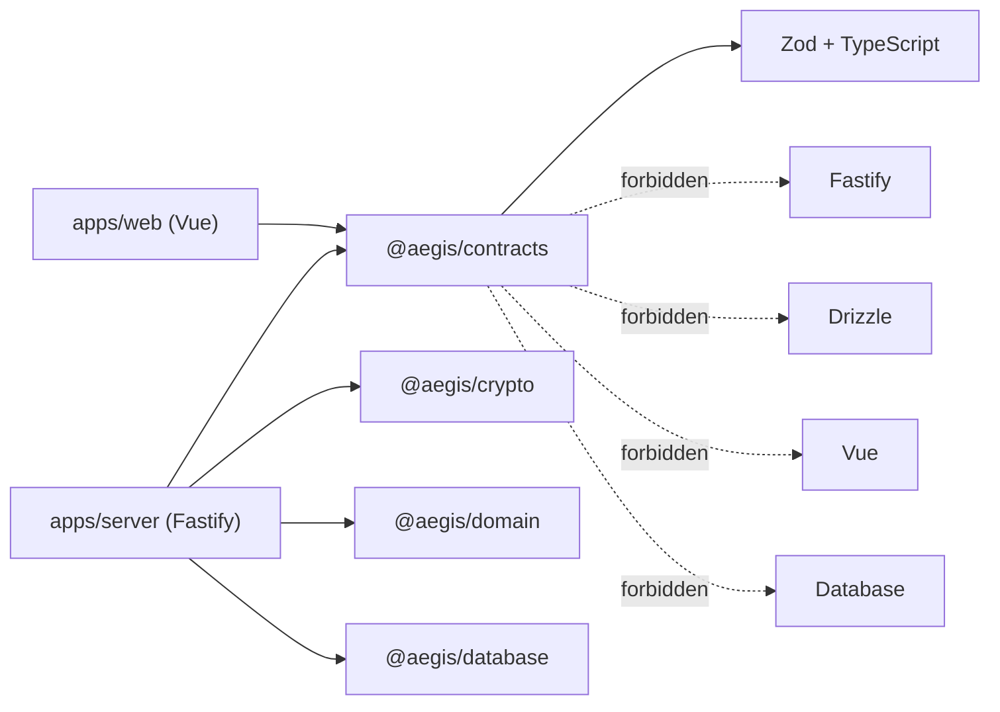
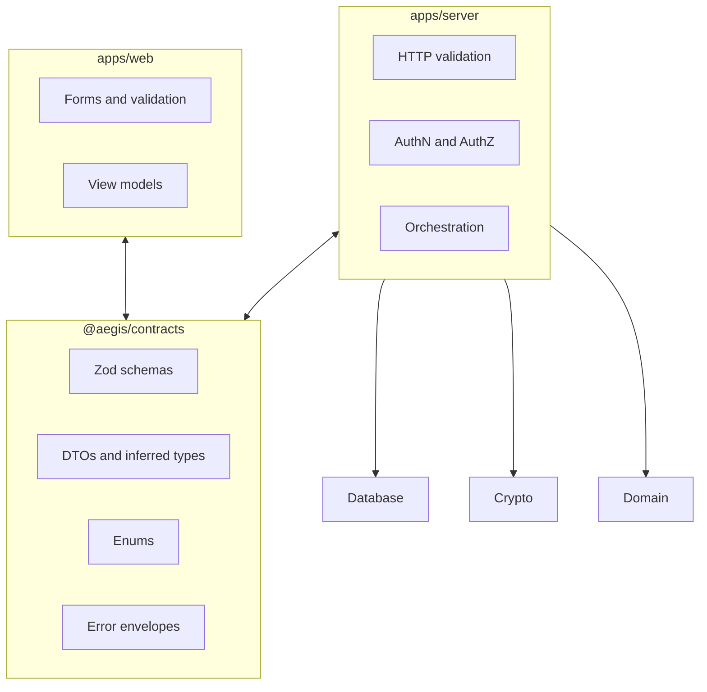
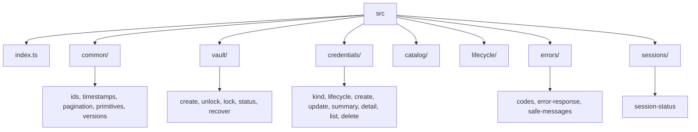
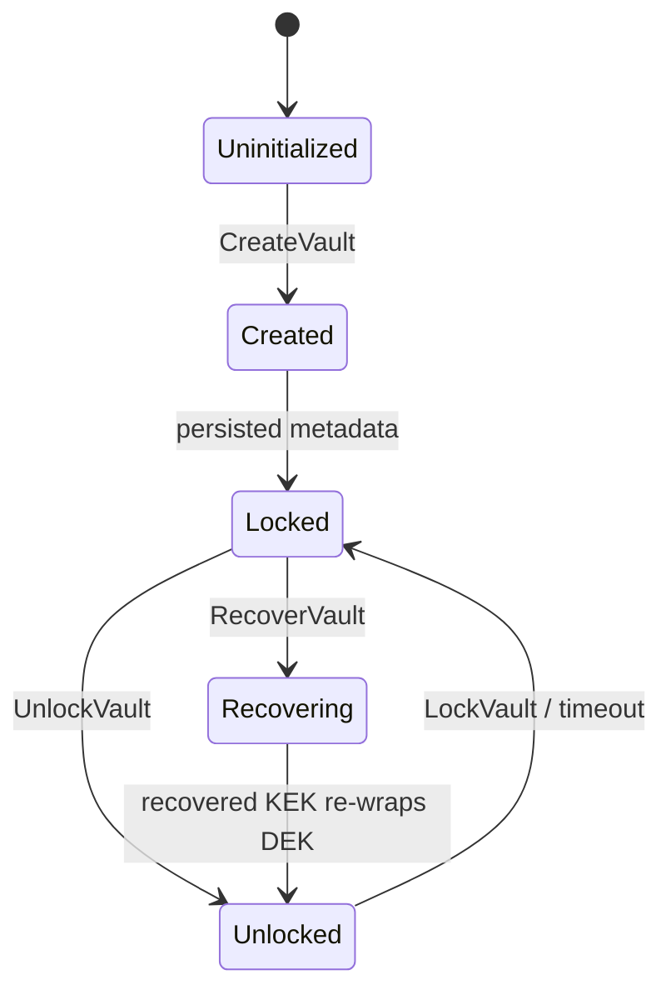
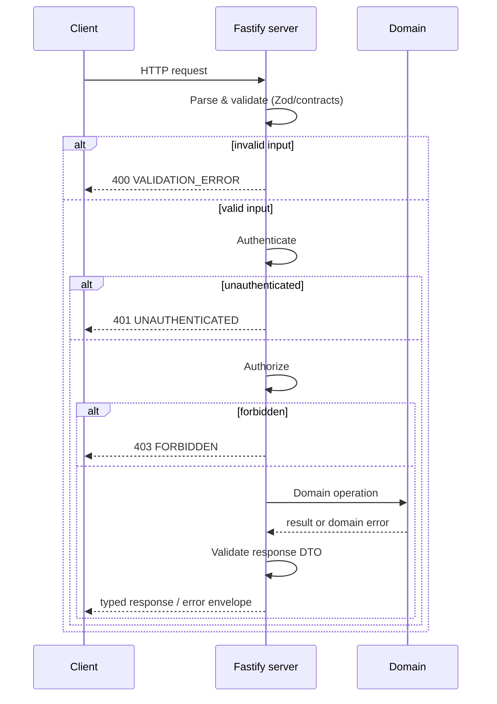
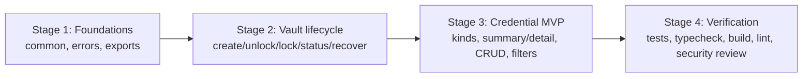
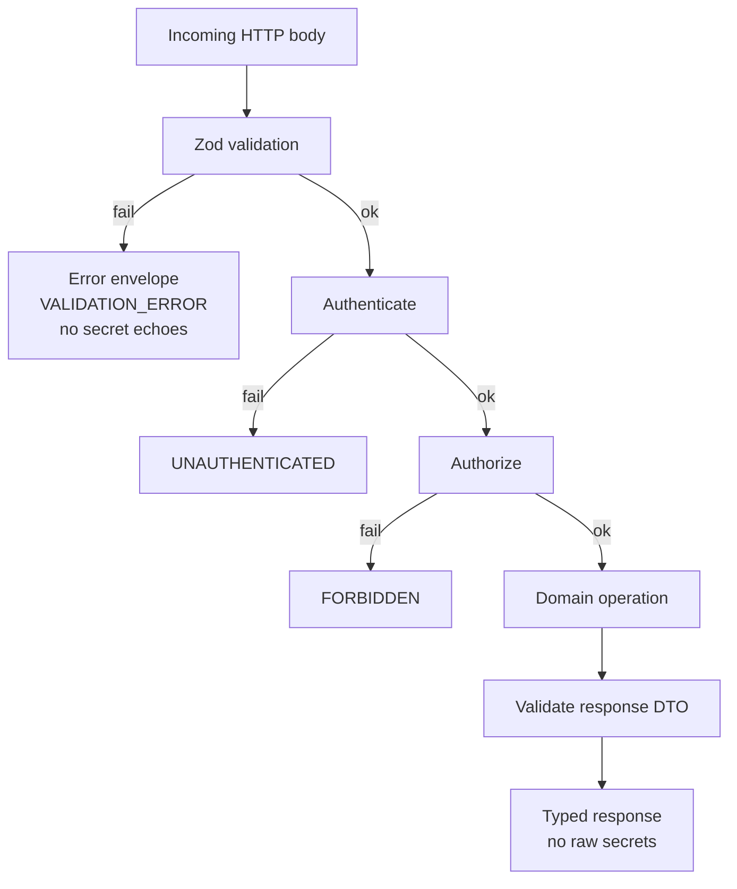

# @aegis/contracts

Shared Zod schemas, DTOs, enums, error envelopes, and inferred TypeScript types for Aegis.

`@aegis/contracts` is the **single source of truth** for the data exchanged between Aegis components. It describes what enters the system, what leaves it, and how failures are represented — without deciding how the database, cryptography, or business logic implements those operations.

## 1. Purpose and boundaries

Aegis is a **local-first encrypted vault**. Contracts therefore enforce clear boundaries around secrets, key material, and sensitive responses. A schema validates the _shape_ of data; it does **not** establish authorization, unlock state, or correct encryption. Those are runtime responsibilities of the server, crypto package, and domain layer.

### Dependency rule

- `contracts` **may** depend on `zod` and TypeScript only.
- `contracts` **must not** depend on Fastify, Drizzle, Vue, or any database implementation.
- `contracts` must remain usable by both `apps/web` and `apps/server`.



### Non-goals

- No database calls, encryption, session mutations, or authorization decisions.
- No Fastify hooks, Drizzle schema definitions, or Vue view-model logic.
- No unwrapped DEK, KEK, master password, or recovery secret in any response.

## 2. System boundaries



### Classification: data vs. runtime responsibility

| Concern                                | Owner                                |
| -------------------------------------- | ------------------------------------ |
| Shape validation of requests/responses | `contracts` (Zod)                    |
| Authentication & authorization         | `apps/server`                        |
| Unlock/lock session state              | `apps/server` + `sessions` contracts |
| Encryption and key management          | `@aegis/crypto`                      |
| Business rules                         | `@aegis/domain`                      |
| Persistence                            | `@aegis/database`                    |

## 3. Proposed package structure

Keep the package focused and modular. Each file has one clear responsibility and a deliberate public export surface. `src/index.ts` contains **named public exports only**; no wildcard barrel exports.

```
packages/contracts/src/
├── index.ts
├── common/
│   ├── ids.ts
│   ├── timestamps.ts
│   ├── pagination.ts
│   ├── primitives.ts
│   └── versions.ts
├── vault/
│   ├── create-vault.ts
│   ├── unlock-vault.ts
│   ├── lock-vault.ts
│   ├── vault-status.ts
│   └── recover-vault.ts
├── credentials/
│   ├── credential-kind.ts
│   ├── credential-lifecycle.ts
│   ├── create-credential.ts
│   ├── update-credential.ts
│   ├── credential-summary.ts
│   ├── credential-detail.ts
│   ├── list-credentials.ts
│   └── delete-credential.ts
├── catalog/
│   ├── providers.ts
│   ├── accounts.ts
│   ├── tags.ts
│   ├── aliases.ts
│   └── usage-references.ts
├── lifecycle/
│   ├── validity.ts
│   ├── reminders.ts
│   └── events.ts
├── errors/
│   ├── codes.ts
│   ├── error-response.ts
│   └── safe-messages.ts
├── sessions/
│   └── session-status.ts
└── *.test.ts
```

Module containment view:



This is the **target** structure, not a claim that every directory already exists. Start with the smallest set needed for the initial vault-creation flow, then expand as each feature is implemented.

## 4. Common primitives

Reused throughout the package.

| Primitive      | Design                                                              |
| -------------- | ------------------------------------------------------------------- |
| Entity ID      | UUID, validated at the boundary                                     |
| Timestamp      | ISO 8601 UTC string in API DTOs                                     |
| Pagination     | Bounded `limit` and opaque or validated cursor                      |
| Enum           | Explicit string values, never arbitrary strings                     |
| Optional field | Distinguish omission from explicit `null`                           |
| Version        | Explicit schema or envelope version where compatibility requires it |

Avoid putting database row types into the contracts package. A database timestamp, encrypted column, or internal foreign key should not automatically become part of a public response.

### Strict object conventions

1. **Strict object schemas**: reject unknown keys on security-sensitive requests unless a specific forward-compatibility need justifies otherwise.
2. **Bounded input**: limit string lengths, array sizes, pagination, and encrypted payload sizes.
3. **Inferred types**: derive TypeScript types from Zod schemas (`z.infer`) instead of maintaining duplicate interfaces.
4. **Explicit public exports**: expose only intentional public schemas and types through `src/index.ts`.
5. **No business logic**: no database calls, encryption operations, session mutations, or authorization decisions.
6. **No secret leakage**: never include secret values in error messages, debug output, or default summary DTOs.
7. **Stable evolution**: test compatibility and explicitly version contracts when a breaking change requires it.
8. **No unsafe coercion**: do not silently transform malformed identifiers, enum values, or security-sensitive input into accepted values.

## 5. Vault contracts

The vault lifecycle is modelled explicitly.



States:
- **Uninitialized**: no vault has been created.
- **Created**: DEK generated; wrapping and recovery envelopes established.
- **Locked**: persisted vault metadata and wrapped key material.
- **Unlocked / Locked**: session-controlled access to vault operations.

### Contract families

- `CreateVaultRequestSchema`
- `CreateVaultResponseSchema`
- `UnlockVaultRequestSchema`
- `UnlockVaultResponseSchema`
- `LockVaultResponseSchema`
- `VaultStatusResponseSchema`
- `RecoverVaultRequestSchema`
- `RecoverVaultResponseSchema`

### Security boundary

The API **must not** return the unwrapped DEK, KEK, master password, or recovery secret. The recovery flow must be designed around the actual cryptographic architecture — not a generic `recoveryKey: string` field added without thought.

### Crypto as source of truth

`@aegis/crypto` owns the envelope format. Its `VaultKeyEnvelope` is the source of truth for cryptographic metadata:
- `version` (`ENVELOPE_VERSION = 1`)
- `kdf`: `argon2id` parameters and salt (base64url)
- `wrap`: `xchacha20-poly1305` nonce + ciphertext (base64url, DEK + 16-byte tag)

Contracts may validate a **suitable transport representation** of this envelope (a transport `VaultKeyEnvelopeSchema`) but must **not** duplicate cryptographic derivation or envelope-verification logic. Verification delegates to `validateVaultKeyEnvelope` from `@aegis/crypto`.

```ts
// Conceptual (server-side) boundary:
// contracts: shape validation of the envelope transport object
// crypto:   validateVaultKeyEnvelope(...) performs real verification
```

Recovery is not a string field: it is modelled as an additional recovery envelope produced by the crypto package (e.g. a second wrapping of the same DEK under a recovery-derived key), validated at the boundary and verified by `@aegis/crypto`.

## 6. Credential contracts

Credentials are the main vault records. Aegis distinguishes **user-facing metadata** from **encrypted secret content**.

Conceptual record:

```ts
interface CredentialRecord {
	id: string;
	providerId: string | null;
	accountId: string | null;
	title: string;
	kind: CredentialKind;
	lifecycle: CredentialLifecycle;
	createdAt: string;
	updatedAt: string;
}
```

This is a design illustration, not a finalized schema.

### `CredentialKind`

- `password`
- `api_key`
- `access_token`
- `refresh_token`
- `ssh_key`
- `certificate`
- `recovery_code`
- `secure_note`

### `CredentialLifecycle`

Keep lifecycle separate from validity/expiration. A credential can be active in the vault but expired at its provider.

### Contract families

- `CreateCredentialRequestSchema`
- `UpdateCredentialRequestSchema`
- `CredentialSummarySchema`
- `CredentialDetailSchema`
- `ListCredentialsQuerySchema`
- `ListCredentialsResponseSchema`
- `DeleteCredentialResponseSchema`

### Secret content

Prefer a dedicated **encrypted payload representation** rather than a generic `Record<string, unknown>`. If the server stores ciphertext without decrypting it, the contract must make that distinction explicit (e.g. `EncryptedSecretPayload` referencing envelope/nonce/ciphertext, distinct from decrypted `SecretContent`).

Do not expose secret values in list responses by default. A reveal operation, if needed, must be separately authorized and designed to minimize exposure.

## 7. Catalog and lifecycle contracts (later)

Supporting models — not the first implementation milestone.

| Contract family   | Purpose                           |
| ----------------- | --------------------------------- |
| Providers         | Service or vendor identity        |
| Accounts          | A user's account at a provider    |
| Tags and aliases  | Organization and search           |
| Usage references  | Where a credential is used        |
| Credential events | Lifecycle history                 |
| Reminders         | Expiration and rotation reminders |

Schema must distinguish credential metadata from secret payloads: a provider name is ordinary metadata; an API token belongs in encrypted secret content.

## 8. Request validation and error semantics

Every incoming request passes through a deterministic validation pipeline.



Validation must reject invalid input **before** invoking domain operations. Authentication and authorization are separate checks; valid input is not necessarily an authorized operation.

### Stable error codes

- `VALIDATION_ERROR`
- `UNAUTHENTICATED`
- `FORBIDDEN`
- `NOT_FOUND`
- `CONFLICT`
- `VAULT_LOCKED`
- `RATE_LIMITED`
- `INTERNAL_ERROR`

### Error envelope

Consistent envelope with a code, safe message, and optional request ID. Validation details may identify invalid fields but must **not** echo passwords, tokens, recovery material, or other secret values.

```ts
// Conceptual error envelope (inferred from Zod)
// {
//   code: ErrorCode,
//   message: string,        // safe, user-facing
//   requestId?: string,
//   details?: Array<{ field: string; message: string }>, // no secret values
// }
```

Do not expose stack traces, SQL errors, cryptographic internals, or secret-bearing input in API errors.

## 9. Test strategy

Unit tests only — no live PostgreSQL connection or cryptographic execution required.

| Test category   | Required checks                                        |
| --------------- | ------------------------------------------------------ |
| Valid input     | Expected payloads parse successfully                   |
| Invalid input   | Missing fields, wrong types and malformed IDs fail     |
| Unknown fields  | Security-sensitive objects reject extra keys           |
| Bounds          | Oversized strings, arrays and payloads fail            |
| Type inference  | Public types agree with schemas                        |
| Secret handling | Error DTOs and summary responses exclude secret values |
| Compatibility   | Representative API payloads remain stable              |
| Exports         | Only intended public APIs are exported                 |

## 10. Implementation sequence

Stage 1 — Foundations: common primitives, strict schema conventions, shared error codes, error envelopes, public exports.

Stage 2 — Vault lifecycle: create, unlock, lock, status, and recovery contracts aligned with the actual crypto flow.

Stage 3 — Credential MVP: credential kinds, summary/detail DTOs, create/update/delete requests, list filters.

Stage 4 — Verification: tests, type-checking, build, lint, security-focused schema review.

**Scope recommendation**: do not implement every future catalog, reminder, event, and usage-reference contract immediately. Establish the common conventions and the vault-creation flow first, then add the credential MVP contracts. This gives Aegis a stable interface for `apps/server` and `apps/web` without prematurely freezing the entire product's data model.

### Recommended build order



## 11. Public API surface

Expose only intentional public schemas and types through `src/index.ts`. Named exports only:

```ts
// Example (illustrative):
export { CreateVaultRequestSchema } from './vault/create-vault.js';
export type { CreateVaultRequest } from './vault/create-vault.js';
```

Secret-bearing values are never part of the public summary/error DTO surface.

## 12. Mermaid: request lifecycle with secret handling



---

_This README documents the architecture and intended implementation of `@aegis/contracts`. Keep it aligned with `@aegis/crypto`'s envelope format and the server's validation pipeline as those packages evolve._
