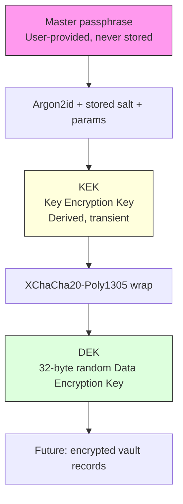

# `@aegis/crypto`

Cryptographic boundary of Aegis. This package owns password-based key
derivation, DEK generation, key wrapping, and validation of versioned key
envelopes. It has no knowledge of UI, database schema, domain entities, or
application routing.

Current status: **Flow A (initial vault key material creation) is
implemented.** Unlocks, record encryption persistence orchestration, and
passphrase changes are not yet implemented as higher-level workflows, but the
necessary primitives (`deriveKek`, `unwrapKey`) are exported.

## Runtime requirements

- Node.js `>= 24.7.0` (uses the built-in `crypto.argon2` API).
- pnpm workspace package `@noble/ciphers` for XChaCha20-Poly1305.

## Key hierarchy



- **Master passphrase** — user secret; never stored or persisted.
- **KEK** — derived from the passphrase via Argon2id; held only in memory.
- **DEK** — 32-byte CSPRNG key that encrypts records.
- **Wrapped DEK** — DEK encrypted under the KEK; safe to persist.

## Supported algorithms

- KDF: `argon2id`
- Key wrap (and future record AEAD): `xchacha20-poly1305`
- Envelope version: `1`

## KDF parameters and bounds

| Parameter | Default | Minimum | Maximum |
| --- | --- | --- | --- |
| `memoryKiB` | 65536 (64 MiB) | 65536 | 262144 (256 MiB) |
| `passes` | 3 | 3 | 5 |
| `parallelism` | 4 | 1 | 4 |
| `tagLength` | 32 | 32 | 64 |
| `saltLength` | 16 | 16 | 64 |

Out-of-range or hostile persisted values are rejected before Argon2id runs.
Values are never silently clamped.

## Envelope format (v1)

Versioned JSON with base64url (no padding) binary fields:

```json
{
  "version": 1,
  "kdf": {
    "algorithm": "argon2id",
    "salt": "<base64url, 16 bytes>",
    "memoryKiB": 65536,
    "passes": 3,
    "parallelism": 4,
    "tagLength": 32
  },
  "wrap": {
    "algorithm": "xchacha20-poly1305",
    "nonce": "<base64url, 24 bytes>",
    "ciphertext": "<base64url, 32-byte DEK + 16-byte tag>"
  }
}
```

The wrapped ciphertext includes the 16-byte Poly1305 tag (noble appends it).
AAD domain separation: `aegis:vault-key-wrap:v1`.

## Implemented public API (Flow A)

- `createVaultKeyMaterial(passphrase)` → validated `VaultKeyEnvelope`
- `deriveKek({ passphrase, salt?, params? })` → `{ kek, salt, params }`
- `generateDek()`, `wrapKey()`, `unwrapKey()`
- `validateVaultKeyEnvelope()`, `createVaultKeyEnvelope()`
- KDF parameter helpers and typed errors

The passphrase, KEK, and raw DEK are never persisted in the envelope. Secret
buffers are cleared best-effort with `fill(0)` / `clean()` after use, but
JavaScript and Node.js cannot guarantee erasure from process memory,
garbage-collected objects, or library-internal copies. Do not treat cleanup
as a hard security guarantee.

## Runtime flow (Flow A)

1. Generate 32-byte DEK (CSPRNG).
2. Derive KEK from passphrase + fresh 16-byte salt (Argon2id).
3. Wrap DEK under KEK (XChaCha20-Poly1305, random 24-byte nonce).
4. Assemble + validate versioned envelope.
5. Return envelope only.

## Out of scope (not implemented)

- Record encryption round-trips as an end-to-end workflow.
- Unlock orchestration convenience function (primitives available).
- Passphrase change and recovery flows.
- Hardware/external keystore integration.

## File layout

```
src/
  errors.ts
  types.ts
  kdf/parameters.ts, derive-key.ts
  keys/generate-dek.ts, wrap-key.ts
  envelope/schema.ts, validate-envelope.ts
  vault/create-vault-key-material.ts
  index.ts
```

Implementation order followed: design → types/errors → KDF/key mgmt →
envelope validation → public API.