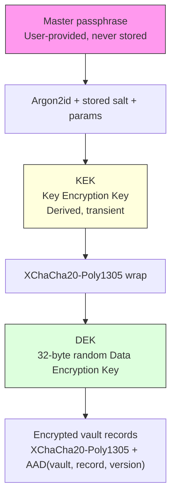

# `@aegis/crypto`

Cryptographic boundary of Aegis. This package owns password-based key
derivation, DEK generation, key wrapping, envelope creation/validation, opaque
vault sessions, and authenticated record encryption. It has no knowledge of UI,
database schema, domain entities, or application routing.

Current status: **vault key material creation (Flow A), opaque vault sessions,
and per-record authenticated encryption are implemented.** Passphrase change and
recovery flows remain out of scope.

## Runtime requirements

- Node.js `>= 24.7.0` (uses the built-in `crypto.argon2` API).
- pnpm workspace package `@noble/ciphers` for XChaCha20-Poly1305.

## Key hierarchy



- **Master passphrase** — user secret; never stored or persisted.
- **KEK** — derived from the passphrase via Argon2id; held only in memory.
- **DEK** — 32-byte CSPRNG key that encrypts records; owned by a `VaultSession`.
- **Wrapped DEK** — DEK encrypted under the KEK; safe to persist.

## Supported algorithms

- KDF: `argon2id`
- Key wrap / record AEAD: `xchacha20-poly1305`
- Envelope version: `1`; record encryption version: `1`

## KDF parameters and bounds

| Parameter     | Default        | Minimum           | Maximum           |
| ------------- | -------------- | ----------------- | ----------------- |
| `memoryKiB`   | 65536 (64 MiB) | 65536             | 262144 (256 MiB)  |
| `passes`      | 3              | 3                 | 5                 |
| `parallelism` | 4              | 1                 | 4                 |
| `tagLength`   | 32             | 32 (exact, fixed) | 32 (exact, fixed) |
| `saltLength`  | 16             | 16                | 64                |

Out-of-range or hostile persisted values are rejected before Argon2id runs.
Values are never silently clamped.

## Envelope format (v1)

Versioned JSON with base64url (no padding) binary fields:

```json
{
	"version": 1,
	"kdf": {
		"algorithm": "argon2id",
		"salt": "<base64url, 16 bytes>",
		"memoryKiB": 65536,
		"passes": 3,
		"parallelism": 4,
		"tagLength": 32
	},
	"wrap": {
		"algorithm": "xchacha20-poly1305",
		"nonce": "<base64url, 24 bytes>",
		"ciphertext": "<base64url, 32-byte DEK + 16-byte tag>"
	}
}
```

The wrapped ciphertext includes the 16-byte Poly1305 tag (noble appends it).
Wrap AAD domain separation: `aegis:vault-key-wrap:v1`.

## Record encryption format (v1)

Records are encrypted with XChaCha20-Poly1305 under the session DEK:
- Fresh random 24-byte nonce per encryption operation.
- 16-byte Poly1305 tag appended to the ciphertext.
- AAD is a **length-prefixed, domain-separated** encoding binding
  `{ label 'aegis:credential:v1', encryptionVersion, vaultId, recordId }`.
  Each field is prefixed with a 32-bit big-endian length, so distinct field
  tuples cannot collide through delimiter ambiguity. A ciphertext copied to
  another record or vault fails authentication.
- Serialized plaintext is capped at `MAX_RECORD_PLAINTEXT_BYTES` (65 536);
  ciphertext at `MAX_RECORD_CIPHERTEXT_BYTES` (65 552).

`RECORD_ENCRYPTION_VERSION` (how ciphertext is interpreted) is distinct from the
credential **payload schema version** (how decrypted fields are interpreted),
which is owned by the domain layer.

## Public API (narrowed)

`@aegis/crypto` deliberately exposes only the high-level, key-free surface:
- `createVaultSession({ vaultId, passphrase })` → `{ envelope, session }`
- `unlockVaultSession({ vaultId, passphrase, envelope })` → `VaultSession`
- `VaultSession` — opaque `{ vaultId, isDisposed, encryptRecord, decryptRecord, dispose }`
- `createVaultKeyMaterial(passphrase)` → validated `VaultKeyEnvelope` (envelope only)
- `validateVaultKeyEnvelope()`, `VaultKeyEnvelope*`, `ENVELOPE_VERSION`,
  `KDF_ALGORITHM`, `WRAP_ALGORITHM`, base64url helpers
- Record format constants (`RECORD_ENCRYPTION_VERSION`,
  `MAX_RECORD_PLAINTEXT_BYTES`, …)
- Typed errors, including `SessionDisposedError` and `RecordSizeError`

### Intentionally internal (not exported)

Low-level key primitives (`deriveKek`, `generateSalt`, `generateDek`,
`DEK_LENGTH`, `wrapKey`, `unwrapKey`, `WRAP_AAD`, `createVaultKeyEnvelope`, KDF
parameter tables, `validateKdfParameters`) and the raw-DEK record AEAD helpers
(`encryptRecord`, `decryptRecord`, `encodeRecordAad`) are **package-internal**.
They are imported by relative path within the package (session implementation and
tests) and are **not** part of the public `.` entry.

**Therefore, no public export of `@aegis/crypto` returns or accepts raw DEK/KEK
bytes.** Application and domain code must use `VaultSession`.

The passphrase, KEK, and raw DEK are never persisted. The session holds the DEK
in a true private (`#`) field and is not serializable (`JSON.stringify(session)`
yields `{}`). Secret buffers are cleared best-effort with `fill(0)` / `clean()`
after use, but JavaScript and Node.js cannot guarantee erasure from process
memory, garbage-collected objects, or library-internal copies. Do not treat
cleanup as a hard security guarantee.

## Runtime flows

**Create:** generate DEK → derive KEK (fresh salt) → wrap DEK → assemble +
validate envelope → return `{ envelope, session }` (local DEK/KEK wiped).

**Unlock:** validate envelope (structure, version, KDF bounds) → derive KEK from
persisted salt/params → unwrap DEK → return session. A wrong passphrase or
tampering surfaces as `AuthenticationError`; no session is produced on failure.

**Use after disposal:** `encryptRecord`/`decryptRecord` on a disposed session
throw `SessionDisposedError`.

## Out of scope (not implemented)

- Passphrase change and recovery flows.
- Key rotation and envelope migration.
- Hardware/external keystore integration.

## File layout

```
src/
  errors.ts
  types.ts
  kdf/parameters.ts, derive-key.ts
  keys/generate-dek.ts, wrap-key.ts
  envelope/schema.ts, validate-envelope.ts
  records/record-encryption.ts        (internal)
  session/vault-session.ts            (interface public; class internal)
  vault/create-vault-key-material.ts
  vault/create-vault-session.ts
  vault/unlock-vault-session.ts
  index.ts
```
