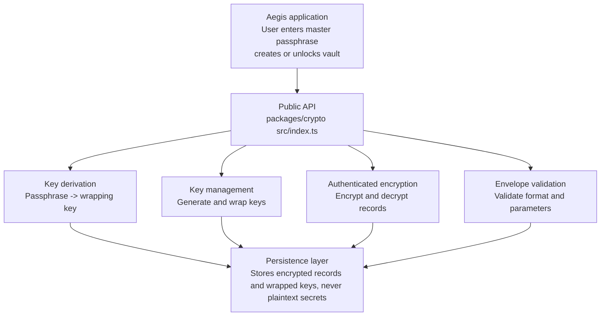
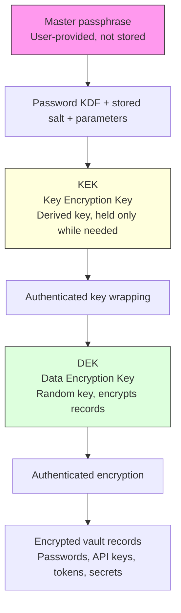
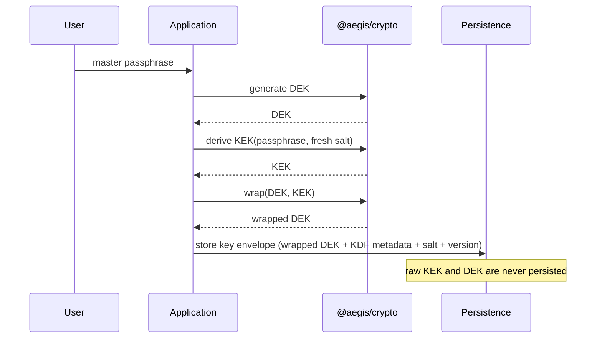
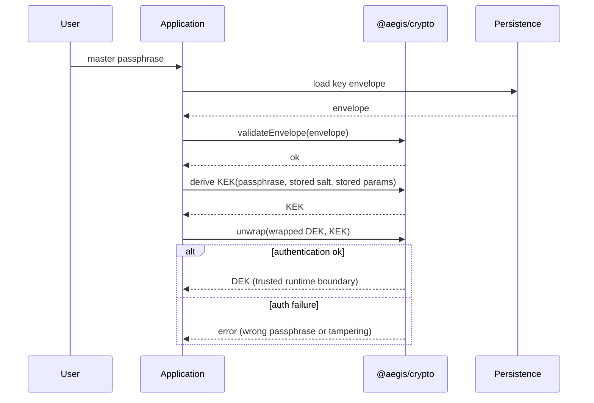
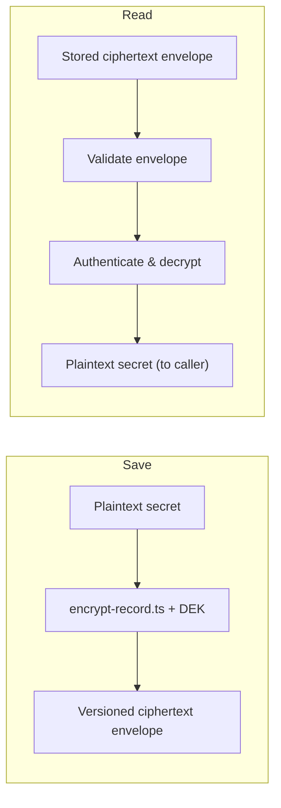
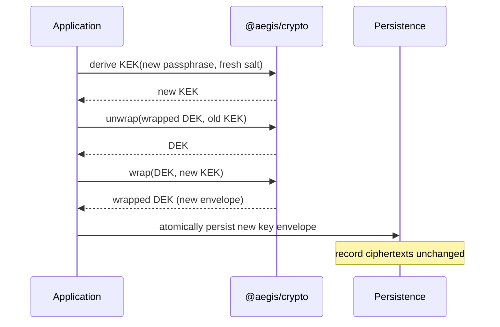

# `@aegis/crypto`

The cryptographic boundary of Aegis. This package handles password-based key derivation, DEK generation and wrapping, authenticated encryption of vault records, and validation of encrypted envelopes. It is intentionally agnostic about your UI, database, domain model and routing.

> ⚠️ **Status: planned, not implemented.** `src/index.ts` currently exposes only a placeholder package name. The content below describes the agreed architecture and implementation order. Actual encryption code should only be written after the design review in [§ 6](#6-implementation-order).

## 1. The big picture

Aegis is a local-first, encrypted vault for passwords, API keys, access tokens and other sensitive credentials. `@aegis/crypto` is the single place where cryptographic work happens.



This is a logical dependency diagram, not a claim that the package or its interfaces exist already.

## 2. Key hierarchy (central design decision)

The master passphrase must be separated from the key that encrypts records.



- **Master passphrase** — user secret to unlock the vault. Never stored.
- **KEK** — derived from passphrase via password-based KDF. Held only while needed.
- **DEK** — randomly generated key that encrypts vault records.
- **Wrapped DEK** — DEK encrypted under KEK, safe to persist without raw DEK in plaintext.

**Why two keys?** Changing the master passphrase can mean deriving a new KEK and re-wrapping the DEK instead of decrypting and re-encrypting every record.

Exact KDF, AEAD algorithm, key sizes, envelope version, recovery mechanism and parameter limits must be decided and reviewed before implementation. They should not be invented independently in individual files.

## 3. Proposed directory and file structure

Current `packages/crypto` is only a placeholder. Treat as proposed layout, not an existing tree.

```
packages/crypto/
├── package.json
├── tsconfig.json
├── src/
│   ├── index.ts            # Public API; implements nothing
│   ├── types.ts            # Keys, envelopes, KDF params, I/O types
│   ├── errors.ts           # Typed errors; never leak plaintext/keys
│   ├── kdf/                # derive-key.ts, parameters.ts
│   ├── keys/               # generate-dek.ts, wrap-key.ts, unwrap-key.ts
│   ├── records/            # encrypt-record.ts, decrypt-record.ts
│   └── envelope/           # schema.ts, validate-envelope.ts
└── tests/                  # Vectors, round trips, tampering, malformed inputs
```

Recovery-related functionality gets its own module only after its security model is agreed.

## 4. Runtime flows

### Flow A — Initial vault creation



1. Generate random DEK (CSPRNG).
2. Derive KEK (fresh salt + approved KDF params).
3. Wrap DEK with KEK (authenticated).
4. Create key envelope (wrapped DEK + metadata). Never persist raw KEK/DEK.

### Flow B — Unlocking the vault



1. Load envelope.
2. Validate version, structure, resource limits before expensive crypto.
3. Derive KEK from passphrase using stored salt/params.
4. Unwrap DEK; auth failure => wrong passphrase or tampering.
5. Return DEK to trusted runtime boundary; keep out of logs/storage/UI.

### Flow C — Saving and reading a record



Decryption must fail if ciphertext, auth tag, or authenticated metadata was altered.

### Flow D — Changing the master passphrase



Record ciphertexts ordinarily do not change because the DEK stays the same.

## 5. Responsibilities

| Responsibility | Owner |
| --- | --- |
| Password-based key derivation | `packages/crypto` |
| DEK generation and wrapping | `packages/crypto` |
| Record encryption and decryption | `packages/crypto` |
| Envelope validation | `packages/crypto` |
| Database tables and migrations | `packages/database` |
| Vault entities and business rules | `packages/domain` |
| Shared request/response contracts | `packages/contracts` |
| Login UI and vault screens | `apps/web` |
| HTTP routes and orchestration | `apps/server` |

Crypto may be called by the server but must not import server, database or web. This keeps it testable and reduces coupling.

## 6. Implementation order

1. Agree on cryptographic design (KDF, AEAD, envelope, nonces, recovery model).
2. Define types and error contracts before internals.
3. Implement KDF and key management; test parameters, DEK gen, wrap/unwrap, wrong passphrase.
4. Implement envelope validation and record encryption; test round trips, auth failures, tampering, malformed input.
5. Expose reviewed API via `src/index.ts`; keep internals private.
6. Integrate with domain/persistence; verify only intended encrypted reps are stored.

Start with design and public interfaces, then one complete create → lock → unlock → encrypt → decrypt cycle.

The next step is defining `packages/crypto/src` public API and data contracts.

## 7. Open questions

- Exact KDF and parameter limits.
- AEAD algorithm and nonce construction.
- Envelope format and version numbering.
- Envelope size/resource limits for pre-validation.
- Recovery mechanism and trust model.
- Whether plaintext passphrases touch the server or stay client-side.
- Key lifetime and zeroization for in-memory DEK/KEK.

These are decisions, not TODOs to settle inside individual files.

---

**Package:** `@aegis/crypto` · **Status:** placeholder · **Runtime dependency:** none (Node built-in `node:crypto`)
