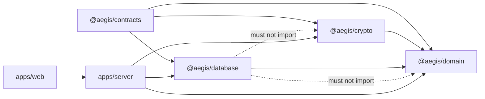
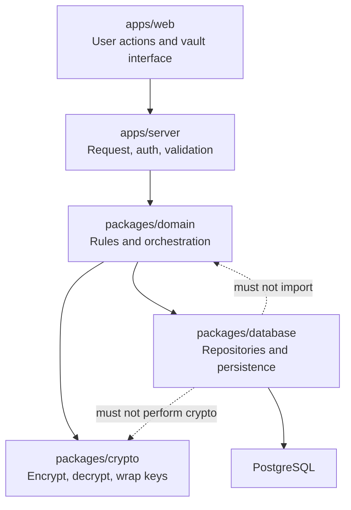
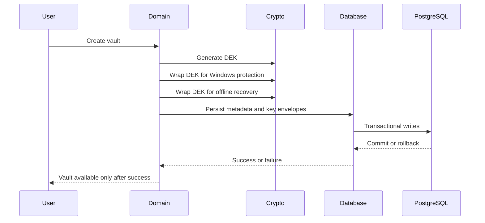
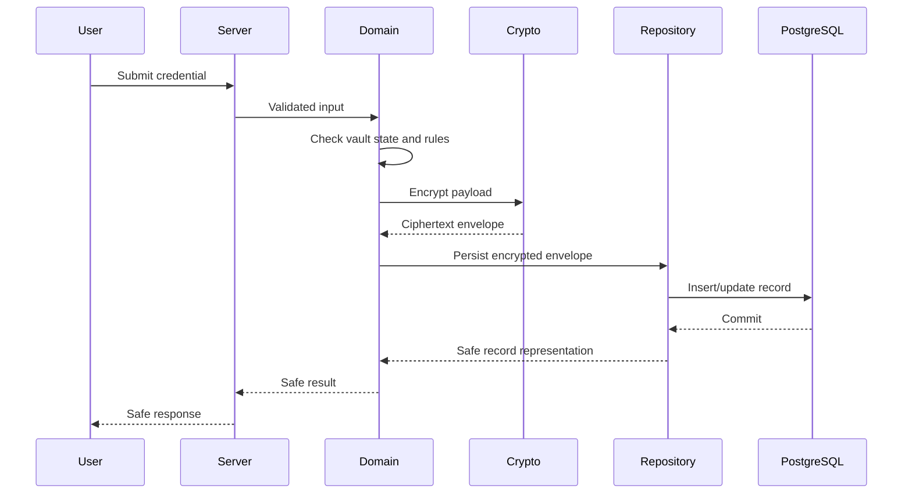
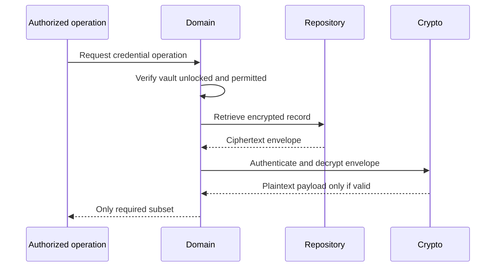
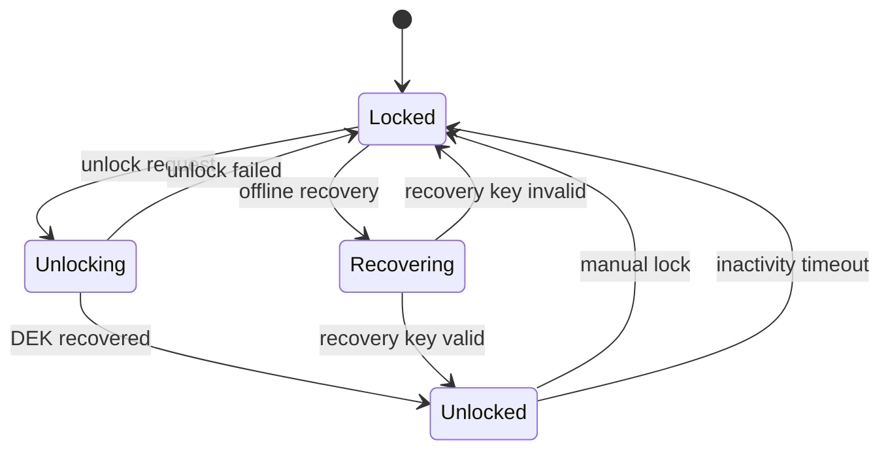

# @aegis/database

Security-sensitive persistence subsystem for Aegis.

This document is the **database design proposal and architecture record**, not an implementation. It is written after a read-only audit of the current Aegis workspace and records the intended boundaries for future implementation. No speculative code changes are proposed by this document.

## 1. Current audit baseline

### Workspace facts observed

- Monorepo: pnpm workspaces (`packages/*`, `apps/*`), TypeScript, ESM, Turborepo, Vitest, Oxlint, Biome.
- Node.js: `>=24.7.0`; pnpm: `>=11`.
- Database is PostgreSQL via Drizzle; Aegis is local-first on Windows and its API must remain private to the local machine.
- `packages/database` currently exposes only `packageName` and has no runtime/package dependencies beyond `@types/node`.
- `packages/crypto` already implements Flow A vault key material, KDF, DEK generation/wrapping, envelope creation, and envelope validation.
- `packages/contracts` currently exposes common primitives, IDs, timestamps, pagination, versions, bounds, and shared error schemas. It does **not** yet define vault persistence entities or repository DTOs.
- `packages/domain` currently exposes only `packageName`.
- `docs/README.md` confirms that application features are intentionally not implemented yet.

### Current dependency graph



### Exact dependency rule proposed for implementation

Dependencies must remain one-way:
- `@aegis/contracts` → no Aegis dependencies.
- `@aegis/crypto` → no Aegis dependencies; may depend on reviewed cryptographic libraries only.
- `@aegis/database` → may depend on `@aegis/contracts` for shared data shapes and validation boundaries. It must **not** import `@aegis/domain` or `@aegis/crypto`.
- `@aegis/domain` → may depend on `@aegis/contracts`, `@aegis/crypto`, and `@aegis/database` repository interfaces/implementations as coordinated boundaries.
- `apps/server` and `apps/web` → consume higher-level packages through their public exports only.

The database package owns durable storage and PostgreSQL/Drizzle concerns. It does not own business rules, cryptographic primitives, or application transport logic.

## 2. Architectural position



| Layer               | Responsibility                                          |
| ------------------- | ------------------------------------------------------- |
| `apps/web`          | User actions and vault interface                        |
| `apps/server`       | Request handling, authentication, input validation      |
| `packages/domain`   | Vault operations, invariants, transaction orchestration |
| `packages/crypto`   | Encrypt, decrypt, derive, and wrap keys                 |
| `packages/database` | Repositories, transactions, persistence                 |

The database package may export:
- Drizzle schemas and migration utilities
- typed repository implementations
- transaction helpers scoped to persistence requirements
- stable database error mappings

The domain layer should depend on stable repository contracts, not Drizzle query builders.

## 3. Persistence model

The following are domain concepts. They are not automatically seven database tables; the physical schema will be decided after contracts and the existing HLD are finalized.

| Entity            | Purpose                                                        |
| ----------------- | -------------------------------------------------------------- |
| `Vault`           | Represents a user’s vault and its lifecycle                    |
| `Provider`        | Identifies services such as GitHub, AWS, or Google             |
| `Account`         | Associates credentials with a service account or identity      |
| `Credential`      | Represents a password, API key, token, or similar secret       |
| `UsageReference`  | Stores references to where a credential is used                |
| `CredentialEvent` | Tracks credential-related events without leaking secret values |
| `Reminder`        | Represents expiry, rotation, or review reminders               |

### Storage boundaries

#### 1. Encrypted payloads — `vault_records`

- Versioned encrypted records for credentials and other sensitive vault data.
- Repository methods persist ciphertext envelopes, not plaintext secrets.
- Each record carries encryption/envelope metadata so that decryption remains version-aware and can fail closed.

#### 2. Vault metadata — `vault_metadata`

- Vault identifiers.
- Encryption format versions.
- Key envelopes containing **wrapped** key material only.
- Raw unwrapped DEKs must never appear in persistence commands, query results, rows, logs, or error messages.

#### 3. Events and settings

- Sensitive event details and settings are encrypted where required.
- Only deliberately classified, non-secret operational metadata may remain plaintext.
- Event tracking must not leak secret values in names, paths, error details, or debug output.

### Metadata and searchability

Metadata can reveal sensitive information. Aegis must explicitly decide which fields may be searched or read without decryption.

Fields such as names, usernames, URLs, tags, and provider identifiers must not be assumed harmless. The schema should make the classification explicit, for example through:
- encrypted fields
- opaque normalized search tokens only when deliberately approved
- separate non-secret operational columns with documented disclosure risk
- no accidental leakage through ordinary database columns, indexes, logs, or error details

## 4. Vault lifecycle and data flow

### A. First-time vault creation



1. User creates a vault.
2. Crypto generates a random Data Encryption Key (DEK).
3. DEK is wrapped for Windows-backed protection and offline recovery.
4. Database transaction persists vault metadata and key envelopes.
5. Vault becomes available only after successful initialization.

Rules:
- The DEK encrypts vault data.
- The database never needs the raw DEK to store or retrieve records.
- Recovery material must be independently usable offline.
- Recovery-key wrapping of the DEK must be defined explicitly.
- Recovery material validation must be defined explicitly.
- Failed initialization must roll back without leaving a partially initialized vault.

### B. Adding a password or API key



1. User submits a credential.
2. Contracts validate the input shape.
3. Domain checks vault state and business rules.
4. Crypto encrypts the sensitive payload.
5. Database repository persists the encrypted envelope.
6. Application returns a safe record representation.

Rules:
- The database must never receive a plaintext credential as part of a persistence command.
- Domain coordinates encryption and persistence.
- Repository accepts only the encrypted representation.
- Partial updates must not overwrite ciphertext envelopes with plaintext fields or discard encryption metadata.

### C. Reading a credential



1. Domain verifies that the vault is unlocked and the requested operation is permitted.
2. Repository retrieves the encrypted record.
3. Domain passes the envelope to `@aegis/crypto`.
4. Crypto authenticates and decrypts the payload.
5. Application returns only the data required by the authorized operation.

Rules:
- A record request does not imply automatic decryption.
- Authenticated decryption must fail closed.
- Corrupted ciphertext, invalid authentication tags, or incompatible envelope versions must not produce partially trusted plaintext.

### D. Locking and recovery



- Manual lock: clear in-memory key material and invalidate unlocked-vault access.
- Inactivity lock: trigger the same lock mechanism after the configured idle period.
- Normal unlock: recover the DEK through the configured Windows-backed protection mechanism.
- Offline recovery: use the independent high-entropy recovery key to unwrap the DEK.
- Failed unlock: leave the vault locked and avoid exposing sensitive failure details.

Locking is not merely UI state. The lifecycle must define behavior for in-flight operations, outstanding key references, decrypted buffers, and concurrent requests. Garbage collection alone cannot guarantee that every copy of a secret has been erased from memory.

## 5. Proposed `packages/database` structure

This is a proposed structure. It should be adjusted to workspace conventions during implementation and should remain as small as coherent scope requires.

```text
packages/database/
├── src/
│   ├── client/          # Connection and lifecycle
│   ├── schema/          # Drizzle table definitions
│   ├── repositories/    # Typed persistence operations
│   ├── transactions/    # Transaction boundaries/helpers
│   ├── errors/          # Database error mapping
│   └── index.ts         # Explicit public exports
├── drizzle/             # Versioned migrations
├── tests/
│   ├── schema/
│   ├── repositories/
│   ├── transactions/
│   └── migrations/
├── package.json
└── tsconfig.json
```

Internal call chain:

```text
Domain service
    │
    ├── Applies business rules
    ├── Calls crypto when required
    │
    ▼
Repository interface
    │
    ▼
PostgreSQL repository implementation
    │
    ├── Drizzle query
    ├── Transaction / constraints
    └── PostgreSQL
```

Avoid unnecessary abstraction. Do not introduce a generic repository framework merely for the sake of having one.

## 6. Transactions and failure handling

Operations requiring atomic transactions should be identified explicitly rather than wrapping every database operation automatically. Likely candidates:
- Vault initialization: metadata plus all key envelopes.
- Credential mutations involving related records.
- Event/reminder updates that must remain consistent with credential state.

Required definitions before implementation:
- transaction boundaries
- uniqueness constraints
- referential integrity constraints
- concurrent update handling
- migration application and testing
- stable database error mapping
- shutdown and connection-failure behavior

Database errors must be mapped to stable internal errors without leaking:
- SQL text
- connection strings
- host/port details
- parameter values
- secrets
- ciphertext internals where their disclosure is unnecessary

## 7. Implementation checklist

Status: unit-level implementation complete; real PostgreSQL integration tests added and run only when `DATABASE_URL` is set (`describe.skipIf`), with CI expected to provision PostgreSQL.
1. Read-only audit
   - Inspect repository tree, package manifests, contracts, crypto exports, tests, workspace scripts, and HLD.
   - Status: in progress / baseline recorded in this document.
2. Architecture proposal
   - Define schema, encrypted envelope representation, repository interfaces, migrations, transaction boundaries, and error mapping.
   - Status: proposed by this document; awaiting discussion and approval.
3. Security review
   - Review metadata leakage, key-material boundaries, constraints, recovery implications, and concurrency risks.
   - Status: outline included; full review pending.
4. Approval checkpoint
   - Present proposed design and wait for explicit approval.
   - Status: not approved yet.
5. Implementation
   - Build smallest coherent database package using existing workspace conventions and explicit exports.
   - Status: not started; must not start until approval, except documentation.
6. Verification
   - Run focused tests, migration tests, type checking, linting, and relevant workspace checks.
   - Status: not started.
7. Read-only audit
   - Review diff, test evidence, dependency boundaries, error paths, and security assumptions.
   - Status: not started.

## 8. Database package deliverable boundary

The immediate deliverable is the database design proposal, not implementation.

Before implementation, the following should be settled:
- Exact physical schema derived from inspected contracts and HLD.
- Repository interface shapes.
- Encrypted envelope persistence contract aligned with `@aegis/crypto`.
- Metadata disclosure classification.
- Migration strategy and testing approach.
- Transaction boundaries and concurrency semantics.
- Error taxonomy.

## 9. After the database package is stable

The next phase is a minimum end-to-end vault vertical slice in `packages/domain`:
1. Initialize a vault.
2. Unlock it.
3. Create an encrypted credential.
4. Retrieve and decrypt that credential.
5. Update and delete it.
6. Lock the vault and verify that subsequent secret access is rejected.
7. Exercise failure cases, recovery, and persistence across application restarts.

Only after that vertical slice is reliable should expansion begin into lifecycle management, backups, richer credential organization, and application interface work.

## 10. Part 1 design gate candidate

This section captures the concrete Part 1 design position. It is still a proposal for discussion and explicit approval. It does not implement code.

### Database technology decision

Use PostgreSQL as the durable store, with Drizzle ORM as the schema, query, and migration tooling.

Primary dependencies to be added later:
- `drizzle-orm`
- `pg`
- `drizzle-kit` as a development dependency for migration generation/checks

### Encrypted record representation

`vault_records`

| Column               | Type / Rule                                                 |
| -------------------- | ----------------------------------------------------------- |
| `id`                 | UUID primary key, validated by `EntityId`                   |
| `vault_id`           | UUID foreign key to `vaults.id`, not null                   |
| `record_type`        | small enumerated text (`credential`, `secure_note`, etc.)   |
| `encryption_version` | integer, currently aligned with crypto envelope version `1` |
| `nonce`              | bytea, 24 bytes                                             |
| `ciphertext`         | bytea, ciphertext plus AEAD authentication tag              |
| `created_at`         | timestamptz UTC                                             |
| `updated_at`         | timestamptz UTC                                             |
| `deleted_at`         | nullable timestamptz UTC for lifecycle decisions            |

The repository stores ciphertext bytes exactly as produced by crypto. It must not decompose or reinterpret AEAD components.

AAD for vault records should bind the record to its vault, record type, encryption version, and ID. The database stores the ciphertext; crypto computes authenticated context. No raw AAD secret is required.

`vaults`

| Column                      | Type / Rule                                                           |
| --------------------------- | --------------------------------------------------------------------- |
| `id`                        | UUID primary key                                                      |
| `status`                    | enumerated lifecycle state (`initializing`, `active`, `locked`, etc.) |
| `encryption_format_version` | integer                                                               |
| `created_at`                | timestamptz UTC                                                       |
| `updated_at`                | timestamptz UTC                                                       |

`vault_key_envelopes`

| Column             | Type / Rule                                       |
| ------------------ | ------------------------------------------------- |
| `id`               | UUID primary key                                  |
| `vault_id`         | UUID foreign key                                  |
| `purpose`          | enumerated: `primary_windows`, `offline_recovery` |
| `envelope_version` | integer                                           |
| `envelope`         | JSONB validated against crypto `VaultKeyEnvelope` |
| `created_at`       | timestamptz UTC                                   |
| `rotated_at`       | nullable timestamptz UTC                          |
| `revoked_at`       | nullable timestamptz UTC                          |

Unique active purposes may be enforced with a partial unique index excluding revoked rows.

### Contract alignment

- IDs should use the existing `EntityId` UUID contract.
- Timestamps may be returned through the repository as ISO UTC strings compatible with `IsoUtcTimestamp`.
- Shared error mapping should align with the existing error-code set where appropriate, with database-specific internal errors added inside `@aegis/database`.
- Domain-facing repository methods should use types exported deliberately by `@aegis/database`, with shared primitives coming from `@aegis/contracts`.

### Repository interfaces (proposed)

- `VaultRepository.createVaultWithKeyEnvelopes(...)`
- `VaultRepository.getVaultById(...)`
- `VaultKeyEnvelopeRepository.listActiveByVaultId(...)`
- `VaultKeyEnvelopeRepository.rotate(...)`
- `CredentialRepository.createEncryptedCredential(...)`
- `CredentialRepository.getEncryptedCredentialById(...)`
- `CredentialRepository.updateEncryptedCredential(...)`
- `CredentialRepository.deleteEncryptedCredential(...)`
- `UsageReferenceRepository`, `CredentialEventRepository`, and `ReminderRepository` for encrypted or classified metadata persistence.

Repositories return storage-oriented representations, never domain business objects and never plaintext secrets.

### Transaction rules

- Vault initialization requires one transaction across vault metadata and all required key envelopes.
- Credential insert/update should support optional atomic companion writes only when required.
- Transaction helpers remain database-local and are not exported as generic frameworks unless domain usage proves the need.

### Approval status

Status: proposed, pending explicit approval before any implementation.

